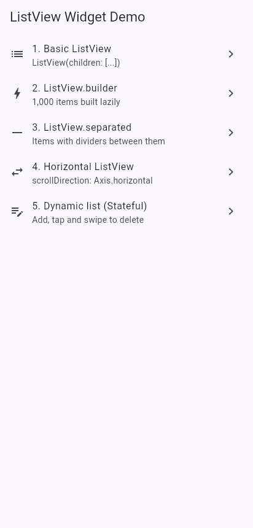
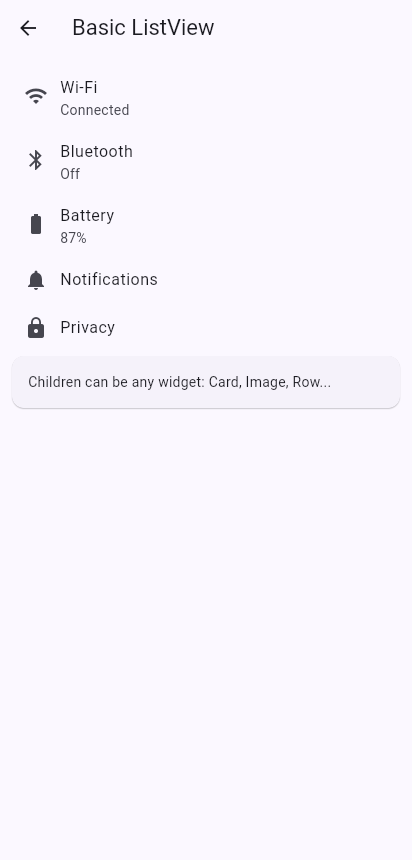
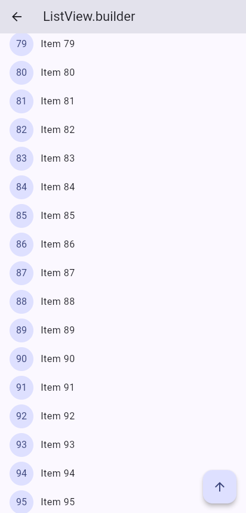
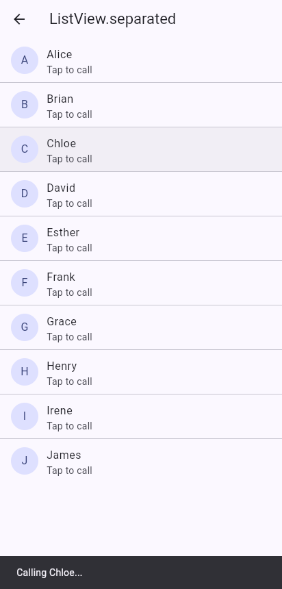
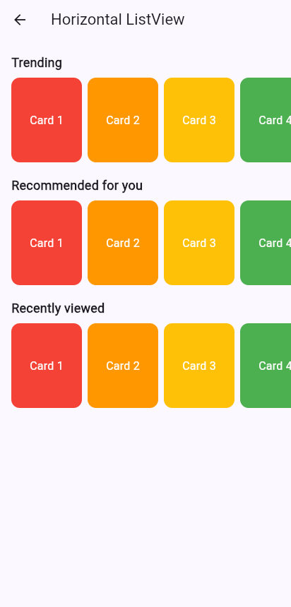
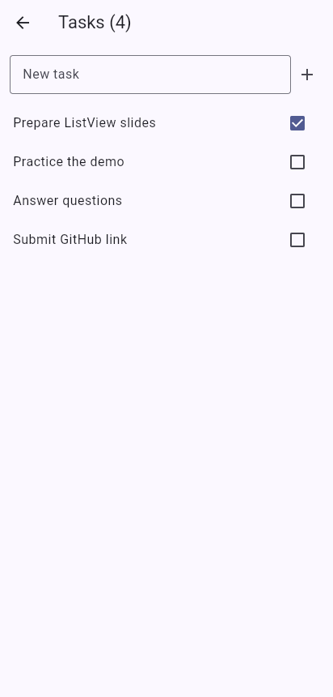
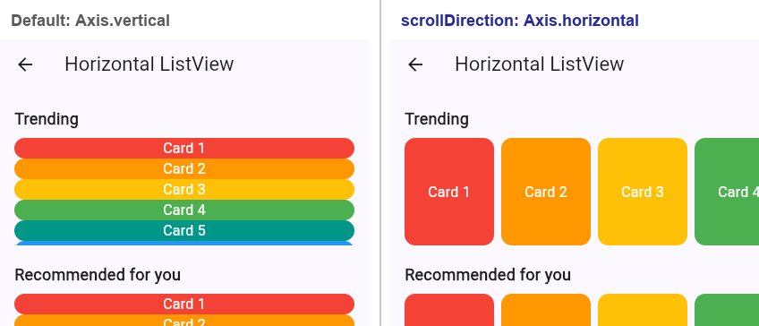
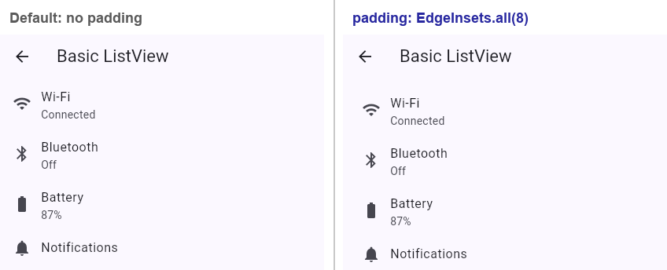
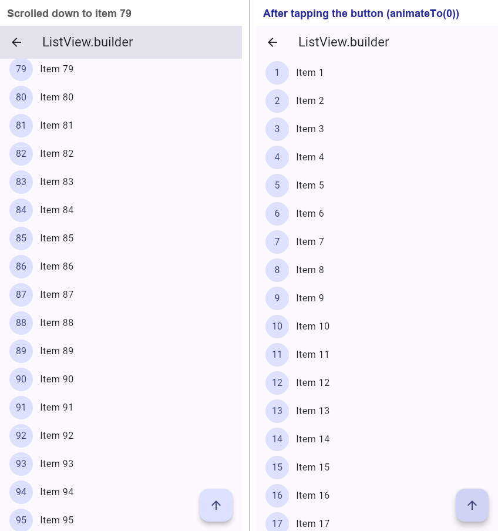

# Flutter ListView Demo

ListView is Flutter's scrollable list widget. It puts its children in a line and lets you scroll when they don't all fit on the screen.



## What I built

A small app with a home menu that opens 5 screens. Each screen demonstrates a different way of using ListView. The home menu itself uses `ListView.builder`.

| Screen | What it does | File |
|---|---|---|
| 1. Basic ListView | A settings-style page with Wi-Fi, Bluetooth, Battery, etc. Uses `ListView(children: [...])`. | `lib/screens/basic_list_screen.dart` |
| 2. ListView.builder | Displays 1,000 items and only builds the ones needed on screen. Also has a button to scroll back to the top. | `lib/screens/builder_list_screen.dart` |
| 3. ListView.separated | A contacts list with dividers between people. Tapping a contact displays a "Calling..." message. | `lib/screens/separated_list_screen.dart` |
| 4. Horizontal ListView | Cards that scroll sideways, similar to Netflix or the Play Store. | `lib/screens/horizontal_list_screen.dart` |
| 5. Dynamic to-do list | Allows you to add tasks, tick them off and swipe to remove them. Uses `setState` to update the list. | `lib/screens/todo_list_screen.dart` |

## Screenshots

| 1. Basic | 2. Builder | 3. Separated |
|---|---|---|
|  |  |  |

| 4. Horizontal | 5. To-do list |
|---|---|
|  |  |

The separated screenshot shows the "Calling Chloe..." message after tapping a contact. The to-do screenshot shows a task I added ("Submit GitHub link") and one that has been ticked off.

## The 3 properties I demonstrated

### 1. `scrollDirection` (Screen 4)

- Default: `Axis.vertical`, so the list goes from top to bottom.
- I changed it to `Axis.horizontal`, so the cards line up from left to right and you can swipe sideways.
- Why use it: For things like carousels and trending sections.
- One thing to watch: A horizontal list inside a normal vertical list needs a fixed height. I used a `SizedBox` with a height of 120.



On the left, the cards are stacked vertically. On the right, they sit side by side and you can scroll through them.

### 2. `padding` (Screens 1 and 4)

- Default: No padding, so items sit close to the screen edges.
- I used `EdgeInsets.all(8)` on the settings list and `EdgeInsets.symmetric(horizontal: 12)` on the card rows.
- Why use it: To give the content some space instead of having everything touch the edges.
- The padding is inside the scroll area, so the content still scrolls through it.



With padding (right), the content moves a little away from the edges.

### 3. `controller` (Screen 2)

- Default: No controller. Flutter manages the scroll position automatically.
- I added a `ScrollController` so I could control the list from my code.
- The arrow button calls `animateTo(0)` and takes the list back to the beginning.
- Why use it: For back-to-top buttons, tracking scroll position and controlling how a list scrolls.
- One thing to remember: The controller needs to be disposed of when it is no longer needed. That's why this screen uses a `StatefulWidget`.



The controller doesn't change how the list looks. It just gives me more control over it. On the left, the list is scrolled down to item 79. On the right, it's back at the beginning after tapping the arrow.

## How to run it

You need Flutter installed and an emulator running, or you can use Chrome.

```bash
git clone https://github.com/nellybutera/flutter-listview-demo.git
cd flutter-listview-demo
flutter pub get
flutter run
```

To run it in Chrome:

```bash
flutter run -d chrome
```

To run the 3 widget tests:

```bash
flutter test
```

## Presentation

Presented in class on Wednesday, 30 September 2026.

## Credits

- Flutter ListView documentation: https://api.flutter.dev/flutter/widgets/ListView-class.html
- Flutter cookbook, long lists: https://docs.flutter.dev/cookbook/lists/long-lists
- Flutter cookbook, horizontal lists: https://docs.flutter.dev/cookbook/lists/horizontal-list
- **AI assistance:** I used Gemini (Web) to help with debugging during development, particularly when I ran into issues with some parts of the code. I reviewed the suggestions and used them to work through the issues.
